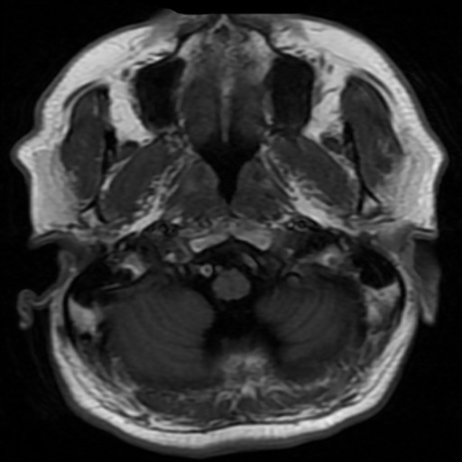
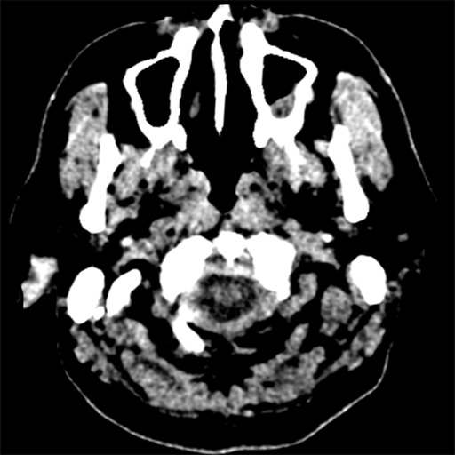
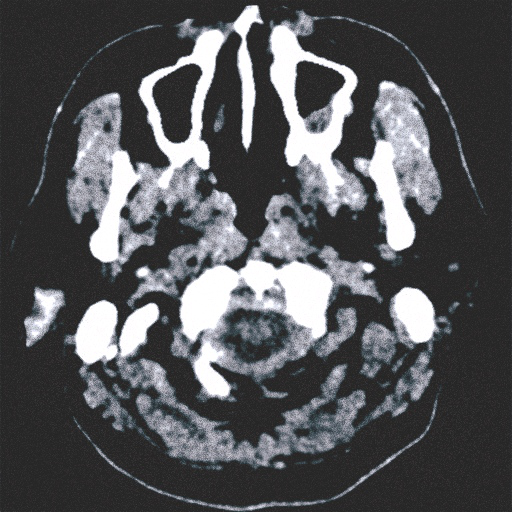

# CycleGAN — MRI ↔ CT Medical Image Translation

---

## Project Overview

This project implements the CycleGAN Model Architecture and applies it to translate:
- **Domain A = MRI scans** → **Domain B = CT scans** (and back)

The key insight from the documentation:
> *"CycleGANs address the limitation [of paired data] by using unpaired image data, making them extremely versatile"*

MRI↔CT is a perfect real-world application because **perfectly registered MRI-CT pairs of the same patient are nearly impossible to obtain** — exactly the problem CycleGAN was designed to solve.

---

### Model Architecture

### Generator: ResNet-based
```
c7s1-64 → d128 → d256 → [R256 × 9] → u128 → u64 → c7s1-1
  ↑ Encoder ↑           ↑ Transformer ↑    ↑ Decoder ↑
```
- **c7s1-k**: 7×7 Conv-InstanceNorm-ReLU, k filters, stride 1
- **dk**: 3×3 Conv-InstanceNorm-ReLU, k filters, stride 2 (downsample)
- **Rk**: Residual block, two 3×3 convolutions
- **uk**: 3×3 fractional-stride Conv-InstanceNorm-ReLU (upsample)

### Discriminator: PatchGAN (70×70)
```
C64 → C128 → C256 → C512 → Conv(1)
```
- **Ck**: 4×4 Conv-InstanceNorm-LeakyReLU, stride 2
- No InstanceNorm on C64 (first layer)
- Output: probability map (each patch = real or fake)

### Training Objectives and Loss Functions
```
L_total = L_GAN(G, Dy) + L_GAN(F, Dx) + λ·L_cyc(G,F) + 0.5λ·L_identity(G,F)
```
- **Adversarial loss** (LSGAN variant for stability)
- **Cycle consistency loss**: F(G(x)) ≈ x  and  G(F(y)) ≈ y
- **Identity loss**: G(y) ≈ y  and  F(x) ≈ x

---

## Project Structure

```text
cyclegan_mri_ct/
│
├── train.py          ← Main training script
├── test.py           ← Run inference on new images
├── evaluate.py       ← Compute MAE / PSNR / SSIM / FID
├── prepare_data.py   ← Download & organize datasets
├── models.py         ← Generator + Discriminator architectures
├── dataset.py        ← PyTorch Dataset (MRI/CT/DICOM support)
├── utils.py          ← ReplayBuffer, LR scheduler, checkpoints
├── requirements.txt  ← Python dependencies
│
├── data/
│   ├── trainA/       ← MRI training images
│   ├── trainB/       ← CT training images
│   ├── testA/        ← MRI test images
│   └── testB/        ← CT test images
│
├── checkpoints/      ← Saved model checkpoints
└── outputs/          ← Generated images & test results
    └── samples/      ← Training samples saved every N epochs
```

## Kaggle Datasets

| Dataset | Link | Domain |
|---------|------|--------|
| Brain MRI | [Brain MRI Dataset](https://www.kaggle.com/datasets/masoudnickparvar/brain-tumor-mri-dataset) | MRI (trainA) |
| RSNA CT Scans | [SIIM Medical Images](https://www.kaggle.com/datasets/kmader/siim-medical-images) | CT (trainB) |
| MRI+CT Combined | [Medical Imaging Datasets](https://www.kaggle.com/datasets/arjunbasandrai/medical-imaging-datasets) | Both |

## Individual Translation Examples

**Input MRI**



**Ground Truth CT**



**Generated CT**



---
